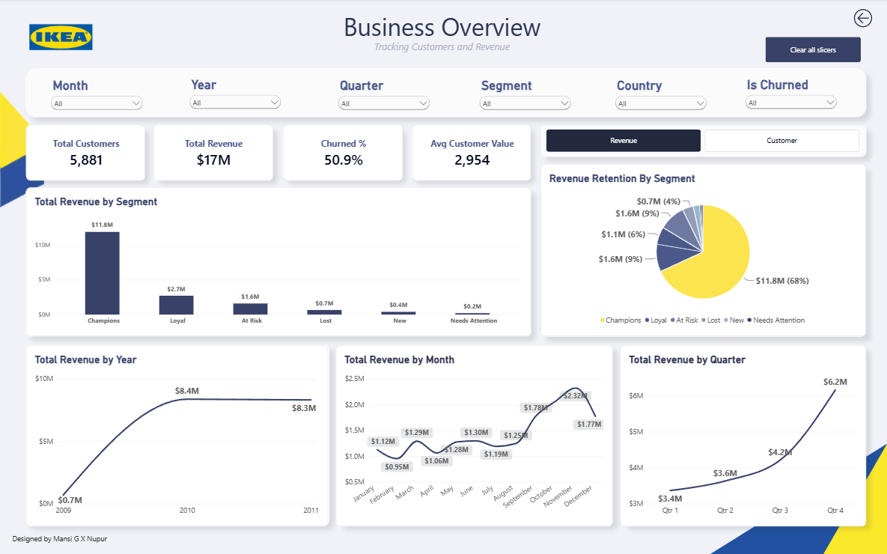
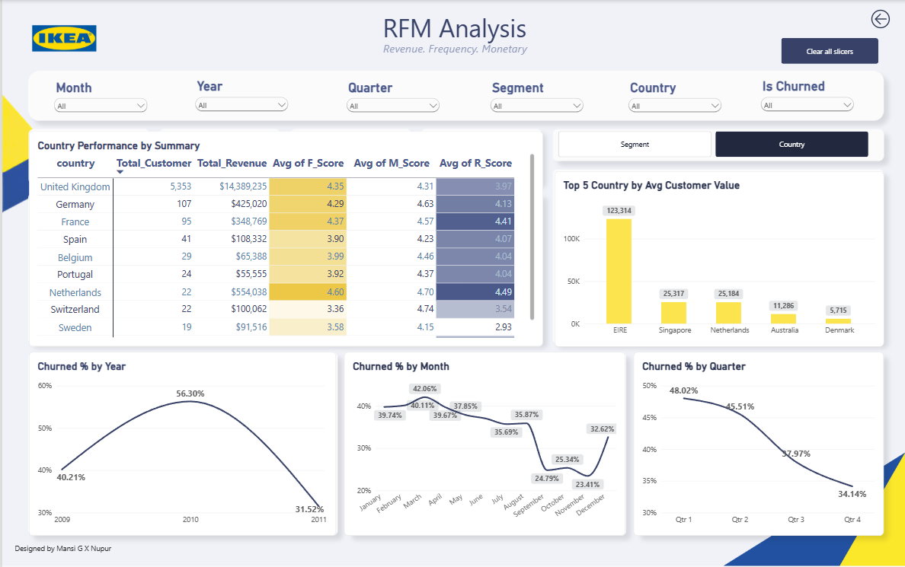
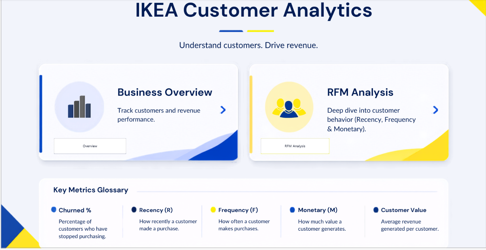

# Customer Analytics & RFM Segmentation Dashboard

**Identifying high-value customers and quantifying churn risk for a UK online gift retailer, using SQL, Python and Power BI.**

   

  
 <table> <tr> <td width="50%">
<b>RFM Analysis</b>
</td> <td width="50%">
<b>Home & Navigation</b>
</td> </tr> </table>

At a glance: 5,881 customers · $17.4M revenue · Champions (22% of customers) drive 68% of revenue · 50.9% churned
## Problem Statement

A UK-based online gift and home-decor retailer had two years of transaction data but no structured, data-driven view of **which customers drive revenue** and **which customers are disengaging**. Retention and marketing efforts were reactive, and spend was applied uniformly instead of being prioritised toward the customers most likely to respond.

**Objective:** segment customers using RFM analysis, quantify churn risk, and give marketing and CRM teams clear, segment-level actions.

### Business questions answered
1. Who are the most valuable customers, and how much revenue do they contribute?
2. Which customers have gone quiet and are at risk of churning?
3. How do customer value and retention trend over time (month, quarter, year)?
4. How do value and churn differ across countries?
5. What action should be taken for each segment?

## Key Results

| Metric | Value |
|---|---|
| Total customers analysed | **5,881** |
| Total revenue | **$17.4M** |
| Churned customers (no purchase in trailing 90 days) | **50.9%** |
| Average customer value | **$2,954** |

### Segment performance

| Segment | Customers | Revenue | Share of revenue |
|---|---|---|---|
| Champions | 1,291 (22%) | $11.84M | **68%** |
| Loyal | 1,416 (24%) | $2.70M | 16% |
| At Risk | 821 (14%) | $1.59M | 9% |
| Lost | 1,524 (26%) | $0.65M | 4% |
| New | 442 (8%) | $0.39M | 2% |
| Needs Attention | 387 (7%) | $0.20M | 1% |

## Key Insights

- **Revenue is highly concentrated.** Champions are only 22% of customers but generate **68% of revenue**; they average about 49 orders each versus about 1.4 for Lost customers. Losing even a small share of them would hurt disproportionately.
- **Half the customer base is churned.** 50.9% of customers have had no purchase in 90 days. The Lost segment is the largest (1,524 customers), but contributes only 4% of revenue, so the commercial priority is protecting Champions and Loyal customers rather than chasing everyone back.
- **At Risk is the best win-back opportunity.** 821 previously valuable customers (frequency score 3.9, monetary score 3.9) represent $1.59M in revenue and have recently gone quiet.
- **Strong Q4 seasonality.** Revenue climbs through the year, peaking in November ($2.32M); Q4 delivers about $6.2M versus about $3.4M in Q1.
- **The UK dominates.** About 5,353 customers and $14.4M (roughly 83% of revenue) come from the UK. Among international markets, Germany, France and the Netherlands lead on revenue. The Netherlands has few customers (22) but strong frequency and recency scores, and EIRE, Singapore and the Netherlands show the highest average customer value (likely a small number of wholesale-type buyers).
- **Churn shows a downward trend across the year.** Quarterly churn falls from 48% in Q1 to 34% in Q4.

## Customer Segments

| Segment | Definition |
|---|---|
| Champions | Recent, frequent, high-spending customers |
| Loyal | Consistent buyers with moderate to high value |
| At Risk | Previously valuable customers whose recency has dropped |
| New | Recent first-time customers, not yet repeat buyers |
| Needs Attention | Moderate recency but low purchase frequency |
| Lost | No meaningful activity for an extended period |

## Recommendations

| Segment | Recommended Action |
|---|---|
| Champions | VIP rewards, early access to new ranges, referral programme; protect at all costs |
| Loyal | Cross-sell and loyalty incentives to move them towards Champions |
| At Risk | Priority win-back: personalised offers and reminders before they lapse |
| New | Onboarding journey and a second-purchase incentive |
| Needs Attention | Targeted promotions to lift purchase frequency |
| Lost | Low-cost reactivation campaign; keep spend small given low revenue share |

## Approach

1. **Data extraction & cleaning (SQL)**: removed duplicates, missing customer IDs, cancellations and invalid quantities/prices to create an analysis-ready dataset.
2. **RFM scoring (Python)**
   - **Recency:** days since the customer's last purchase
   - **Frequency:** number of distinct purchase transactions
   - **Monetary:** total revenue generated
3. **Segmentation:** R, F and M scores combined to assign each customer to one of six segments.
4. **Churn flag:** a customer is churned if they have **no purchase in the trailing 90 days**.
5. **Dashboard (Power BI):** three pages (Home, Business Overview, RFM Analysis) with slicers for month, year, quarter, segment, country and churn status.

## Tools & Technologies

SQL · Python (Pandas, NumPy) · Power BI (DAX) · Git & GitHub

## Dataset

[Online Retail II](https://archive.ics.uci.edu/dataset/502/online+retail+ii) from the UCI Machine Learning Repository (donated by Daqing Chen): 1,067,371 transactions of a UK-based online retailer, December 2009 to December 2011.

## Conclusion

This analysis shows that the retailer's revenue depends on a small group of customers, and that a large part of its customer base is already inactive.

**What the data tells us**
- **A few customers carry the business.** 22% of customers (Champions) generate 68% of revenue. Protecting them is the top priority.
- **Churn is high but not equally costly.** 50.9% of customers have not bought in 90 days, but the Lost segment, the largest group, contributes only 4% of revenue. Mass win-back campaigns would waste budget.
- **The best opportunity is At Risk customers.** 821 customers who used to buy often and spend well have recently gone quiet, and they hold $1.6M in revenue. Reaching them early costs far less than acquiring new customers.
- **Sales are seasonal.** Q4, and November in particular, drives the most revenue, so retention and loyalty campaigns should be ready before the peak.
- **The business is UK-dependent.** About 83% of revenue comes from the UK. Markets such as the Netherlands, Germany and France show strong engagement and could be grown with targeted campaigns.

**What I learned**
Working end to end on this project, I practised cleaning large transactional data in SQL, building RFM scores and segments in Python, and turning the results into an interactive Power BI dashboard with business-ready recommendations.

## Authors

**Nupur Choure** · [LinkedIn](https://www.linkedin.com/in/nupur-choure-923314390/) 
